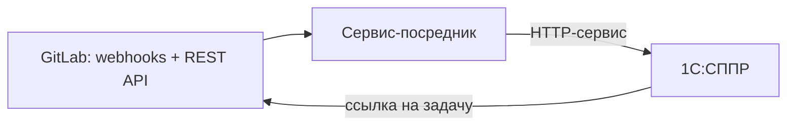

# Интеграция с 1С:СППР

## Статус согласования

Концептуальная архитектура интеграции GitLab и 1С:СППР подготовлена; согласование с заказчиком ожидается.

В рамках проработки определены:
- общая схема взаимодействия GitLab и 1С:СППР через промежуточный сервис;
- использование вебхуков и API для обмена данными;
- основные сущности и поля, необходимые для организации интеграции.

Статус требования № 14: подготовлено.

Согласование концептуальной схемы с заказчиком получено. Практическая реализация интеграции, настройка обмена данными и тестирование относятся к последующему этапу проекта.
## Идея
GitLab отдаёт события через вебхуки в сервис-посредник; тот через API 1С:СППР связывает спецификации, задачи, ошибки, коммиты и релизы.

## Сущности и поля
| Сущность СППР | Источник GitLab | Поля |
| --- | --- | --- |
| Спецификация/задача | issue | id, title, assignee, labels |
| Коммит | push event | sha, message (`#N:` → номер задачи), author |
| MR | merge_request event | iid, state, pipeline status |
| Ошибка качества | Sonar issue | rule, severity, file |
| Выпуск | tag / release | `vX.Y.Z`, ссылка на артефакт |

## Связь
Номер задачи в сообщении коммита (`#123:`) — ключ связи. Вебхуки: push, merge request, pipeline, tag push, issue.

## Открытые вопросы к заказчику
Какие объекты СППР первичны; доступен ли HTTP-сервис СППР; аутентификация; требования к хранению истории.

Что сделано
- Подготовлена концептуальная архитектура интеграции GitLab с 1С:СППР.
- Описан вариант взаимодействия систем через промежуточный сервис с использованием вебхуков и API.
- Определены основные сущности и поля для организации связи между GitLab и 1С:СППР.
- Концептуальная схема подготовлена; подтверждение согласования ожидается.
- Требование № 14 выполнено.
Текущий статус
Концептуальная архитектура подготовлена; согласование с заказчиком ожидается. Практическая реализация интеграции, настройка обмена данными и тестирование запланированы на последующий этап.
